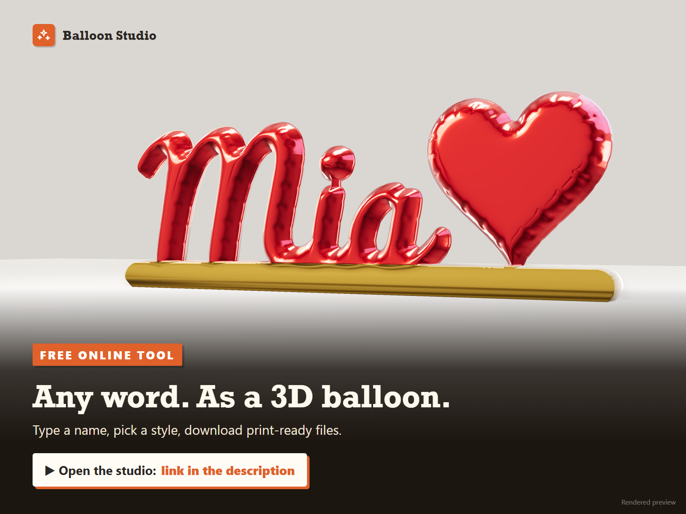
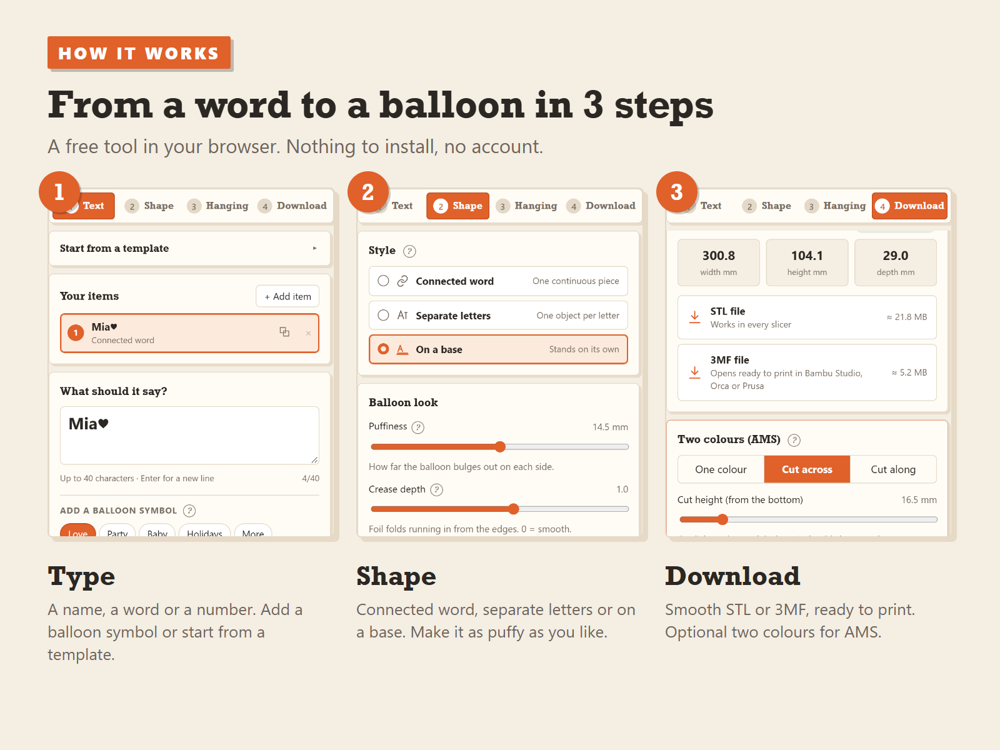
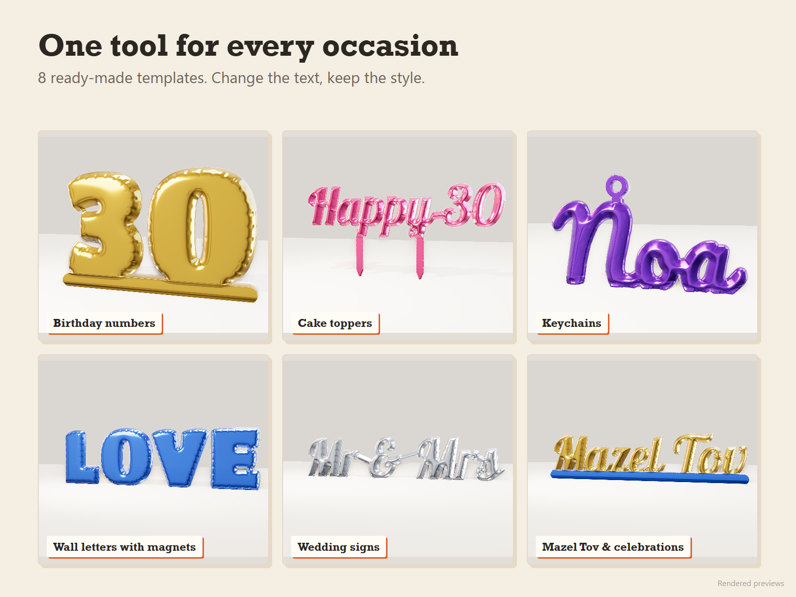
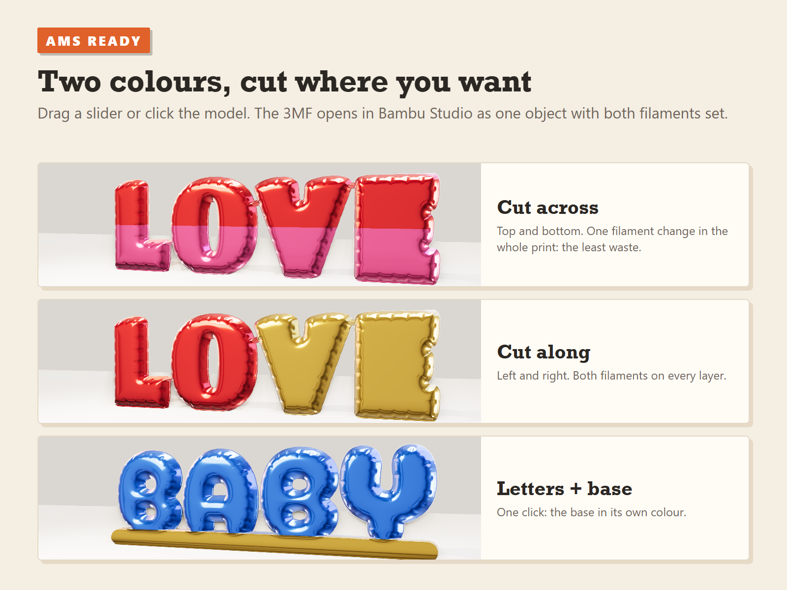
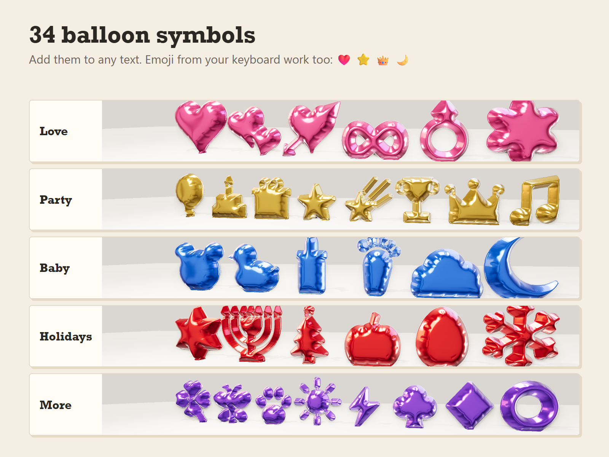
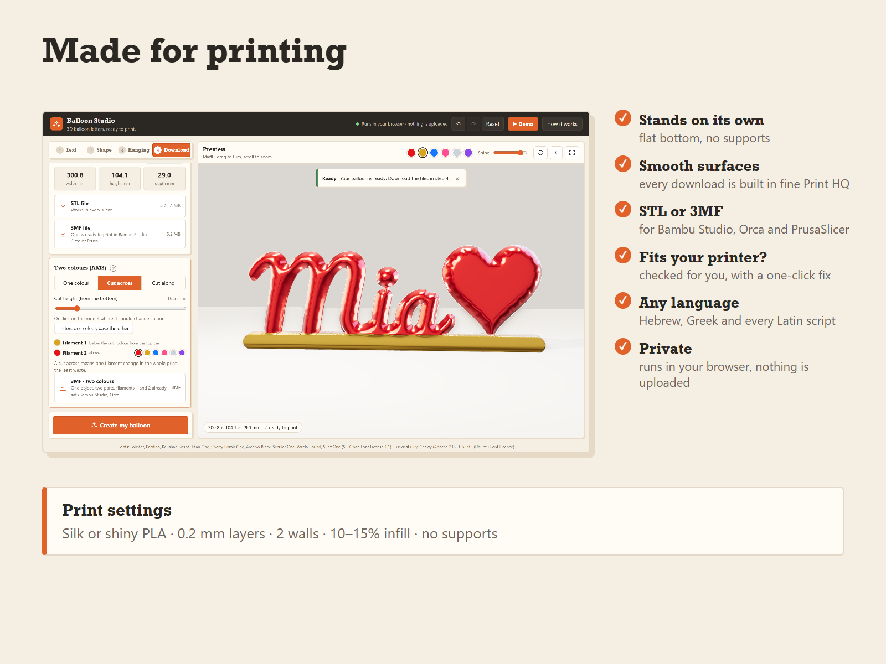

# Balloon Studio

**Any word. As a 3D balloon.**

A free tool that runs in your browser. Type a name, a word or a number, pick a style, and download a print-ready foil-balloon model as STL or 3MF.

### ▶ [Open the studio](https://eliyhoo.github.io/balloon-studio/)

## What it does

- **Three styles:** one connected word, separate letters, or standing on a base.
- **Templates:** birthday numbers, cake toppers, keychains, wall letters, wedding signs and more.
- **34 balloon symbols:** hearts, cakes, stars, crowns, teddy bears, a menorah, snowflakes and more. Emoji typed from the keyboard are turned into symbols.
- **Any language:** Latin scripts, Hebrew and Greek, with 12 open-source fonts.
- **Two colours for AMS:** place a cut across or along the model. The 3MF opens in Bambu Studio as one object with both filaments set.
- **Hanging options:** magnet pockets, a flat back, a hanger tab, a keychain loop, or cake-topper picks.
- **Made for printing:** models stand flat with no supports, every download is built with a fine mesh, and the studio checks the model fits your printer.
- **Private:** everything runs on your computer. Nothing is uploaded.

## Demo

A one-minute walkthrough: [demo.mp4](images/demo.mp4). The ▶ Demo button in the studio plays the same tour live.

## Example file

[`files/example_Mia-heart_on-base_two-colours.3mf`](files/example_Mia-heart_on-base_two-colours.3mf): "Mia♥" on a base, 242 × 29 × 86 mm, two colours (base and letters).

## Offline version

[`balloon-studio.html`](balloon-studio.html) is the whole studio in one file. Download it and open it in any browser; it works without internet.

## Print settings

Silk or shiny PLA · 0.2 mm layers · 2 walls · 10–15% infill · no supports.

## Privacy

The website counts anonymous visits and downloads with [GoatCounter](https://www.goatcounter.com/). It uses no cookies and collects no personal data. The offline file sends nothing, and nothing you type or make is ever uploaded.

## Fonts

Lobster, Pacifico, Kaushan Script, Titan One, Cherry Bomb One, Archivo Black, Secular One, Varela Round and Suez One (SIL Open Font License 1.1), Luckiest Guy and Chewy (Apache 2.0), Ubuntu (Ubuntu Font Licence).

*The pictures are renders.*
